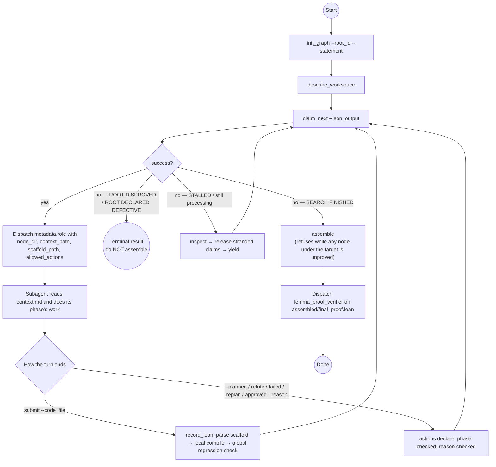
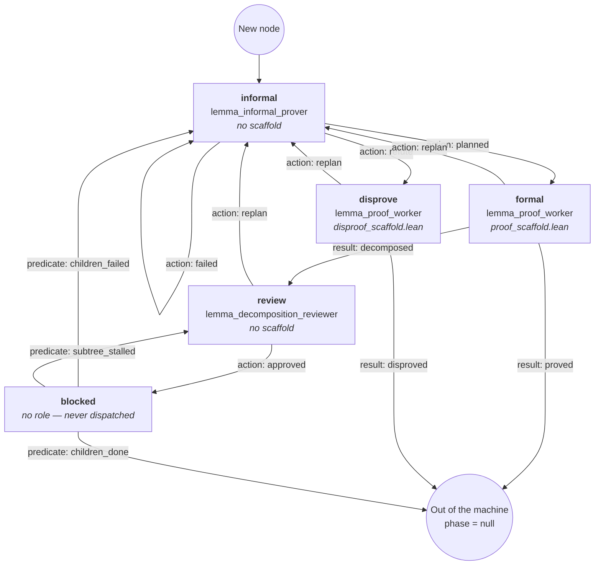
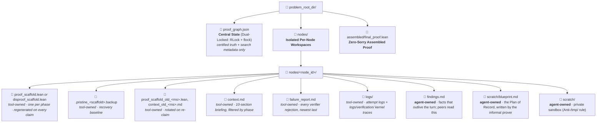

# LEAP Architecture Specification

This document provides the high-level workflow, agent team specifications, and centralized state/workspace management architecture for the LEAP Formal Proof Pipeline.

---

## 1. Overall Pipeline

The pipeline is a **per-node phase machine** driven by an asynchronous Depth-First Search over a proof DAG, coordinated by a centralized, dual-locked state manager.

Every node in the graph sits in exactly one *phase*. The phase — and nothing else — decides which subagent is dispatched against it, which scaffold (if any) it is handed, which sections its briefing renders, and which `--action` values the recorder will accept from it. All four are read back off one value (`pipeline.PIPELINE`), so they cannot disagree.

### Orchestrator Loop



### The Per-Node Phase Machine



Three kinds of edge move a node, and they are three separate fields on `pipeline.Phase` because they have three different authorities. They are deliberately not merged into one dict: `actions` is rendered verbatim into the briefing as the agent's vocabulary, and advertising `decomposed` or `children_done` to a model that cannot cause either is how an agent invents a command.

| Edge kind | Who causes it | Where it is applied |
| :--- | :--- | :--- |
| `actions` | The agent said so, via `--action=<name> --reason="…"`. | `actions.declare` → `pipeline.apply_action` |
| `results` | The submitted file and the Lean kernel said so — never the agent. | `state_manager.record_lean` → `pipeline.apply_result` |
| `predicates` | Arithmetic on the graph said so; no agent is involved. | `claim_next_subgoal`'s DFS walk → `pipeline.apply_predicate_edge` |

The full table (`pipeline.PIPELINE`):

| Phase      | `role`                         | `scaffold` | Briefing sections  | `actions`             | `results`             | `predicates`                  |
| :--------- | :----------------------------- | :--------- | :----------------- | :-------------------- | :-------------------- | :---------------------------- |
| `informal` | `lemma_informal_prover`        | —          | 1,2,3,5,6,7,8,9,10 | `planned`→`formal`,   | —                     | —                             |
:            :                                :            :                    : `refute`→`disprove`,  :                       :                               :
:            :                                :            :                    : `failed`→`informal`   :                       :                               :
| `formal`   | `lemma_proof_worker`           | `prove`    | 1,2,3,4,5,6,7,8,10 | `replan`→`informal`   | `proved`→∅,           | —                             |
:            :                                :            :                    :                       : `decomposed`→`review` :                               :
| `disprove` | `lemma_proof_worker`           | `disprove` | 1,2,3,4,5,7,8,10   | `replan`→`informal`   | `disproved`→∅         | —                             |
| `review`   | `lemma_decomposition_reviewer` | —          | 2,3,5,6,8,9,10     | `approved`→`blocked`, | —                     | —                             |
:            :                                :            :                    : `replan`→`informal`   :                       :                               :
| `blocked`  | *(none)*                       | —          | —                  | —                     | —                     | `children_done`→∅,            |
:            :                                :            :                    :                       :                       : `children_failed`→`informal`, :
:            :                                :            :                    :                       :                       : `subtree_stalled`→`review`    :

`validate_pipeline()` runs at import: every edge target must name a real phase, a phase with a scaffold must be submittable and one without must not be, and `_AGENT_ACTIONS` must equal the union of every phase's `actions`.

### Operational Lifecycle

1.  **Initialization**: `orchestrator_lemma` initializes `proof_graph.json` with
    the problem preamble and root theorem via `init_graph --root_id=<id>
    --statement="…"`, then confirms the layout contract with
    `describe_workspace`. `init_graph` refuses to overwrite a non-empty state
    file. It also refuses a statement it cannot build a sound tree from —
    `graph_init_guard` runs three admission checks before anything is written,
    because every one of these failures is silent at init and expensive hours
    later:
    -   **`check_preamble`** — the statement is split at the root theorem, and
        everything before it becomes the immutable header every scaffold
        renders. An orchestrator that passes only the theorem text instead of
        the whole benchmark file produces an *empty* preamble; the tree then
        proves a statement that is not the benchmark's, and the first symptom is
        an unknown-identifier error several generations down. A preamble with no
        `import` line did not come from a file.
    -   **`check_root_gate`** — the scaffold issued to a node and the extractor
        that validates submissions against it must be inverses. When they are
        not, the node is unsubmittable by construction: no text an agent can
        produce passes the gate, and the rejection tells it to copy a signature
        it already copied. One problem burned ~2h and 215 rejections this way.
    -   **`check_root_compiles`** — a scaffold whose proof is `by sorry` must
        compile. This is the only check here that is not an approximation,
        because the oracle is Lean rather than a regex, and it subsumes the
        textual guards above.
2.  **Atomic Claiming**: the orchestrator claims work via `claim_next`, which
    walks the DAG depth-first inside a single exclusive lock. The walk both
    *finds* the node and *applies the predicate edges* it passes — a `blocked`
    node whose children all finished leaves the machine right there, one whose
    decompositions have all failed goes back to `informal`, and one whose
    subtree is being re-planned without closing anything is pulled into
    `review`. Claims never expire; a crashed worker's node is freed only by
    `--action=release`. Up to 8 workers run concurrently.
3.  **Planning**: `lemma_informal_prover` writes `scratch/blueprint.md` — a
    fully closed mathematical argument, never Lean — and declares `planned`,
    `refute` (it has a witness that the target is false) or `failed`. `failed`
    is *not* a verdict and does not end the node: it lands back on `informal`
    with the reason attached. The distinction it was being asked to carry — "my
    route is closed" versus "this target is unreachable" — is one the action set
    could not express, so agents used it for the first and the system heard the
    second.
4. **Formalization**: `lemma_proof_worker` fills in one scaffold. **Proving and decomposing are the same submission**: an empty `-- [START_SUBGOALS]` block means the target was closed outright, a non-empty one means it was split. The agent never names its own outcome — `record_lean` derives it from the file and the kernel. Stuck, the worker declares `replan` and the node returns to planning.
5.  **Review**: a fresh decomposition lands in `review`, and the DFS will not
    descend past it — children the reviewer may be about to retire are never
    dispatched. `lemma_decomposition_reviewer` rules on the *shape* of the
    split: `approved` releases the children, `replan` retires the plan and
    returns the goal to the planner. The same reviewer is re-entered later by
    the `subtree_stalled` predicate, which fires on *replanning velocity* rather
    than structural depth: it triggers once the live subtree has been re-planned
    more than `SUBTREE_REVIEW_REPLANS_PER_NODE` (4) times per node without
    closing anything.
6. **Refutation**: a node routed to `disprove` gets a scaffold whose obligation is `theorem <id>_disproof : False`, with the target itself handed over as an axiom. A success is terminal and negative: the node dies with the witness attached and its parent backtracks. On the root, that is a successful run with a negative answer.
7. **Assembly & Audit**: `assemble` topologically merges the proved declarations and writes `assembled/final_proof.lean` — but only if **every** node in the active reachable set under the target is `FORMAL_PROVED`. Otherwise it writes nothing and returns the unproved nodes as a worklist. There is no flag to relax this. On success the orchestrator dispatches `lemma_proof_verifier` for an independent kernel and axiom audit.

**There is no attempt budget and no give-up condition.** Nothing in the DFS
kills a node, and no agent can either. A target is settled in exactly one way:
`refute` routes it to `disprove`, and the kernel derives `False` from it. A hard
subtree is re-planned indefinitely, by design.

---

## 2. Agent Team Specifications

Each agent is one Markdown file in `agents/`: frontmatter plus the agent's
full operating protocol (directive, invariants and workflow, in one body).
The frontmatter is host-neutral -- `tools` lists *capabilities* (`shell`,
`read`, `write`, `edit`, `list`, `web`, `subagents`, `tasks`), not one CLI's
tool names -- and `leap init <claude|codex|antigravity>` renders it
into the layout and tool names that host reads, appending a short "Host
notes" section on dispatch and shell timeouts. See [configuration.md](configuration.md) for the layouts.

The Strict Command Policy in each directive -- which binaries the shell may
invoke -- is the constraint that actually matters; the host tool allow-list is
a second line of defence.

The blocks below summarise each agent's contract. They are a reading aid, not
the file format; the source of truth is `leap/agents/<name>.md`.

### 2.1. `orchestrator_lemma`

```json
{
  "name": "orchestrator_lemma",
  "role": "Dispatch-Only Coordinator",
  "directive": "Routes the proof DAG lifecycle and dispatches specialized subagents. Never writes Lean, never writes a plan, never rules on a decomposition, and never records an action on a subagent's behalf.",
  "invariants": [
    "You route; the state manager decides. claim_next answers which node, which phase and which role. Never second-guess, reorder, or skip.",
    "The only agent permitted to invoke subagents. No subagent may spawn another; every dispatch in the run passes through here.",
    "Decomposed parents resolve automatically when their children finish. Never submit on a parent's behalf; its formal_theorem stays null by design.",
    "The only source of truth for completion is --action=assemble, which refuses and writes nothing while any node under the target is unproved. Never hand-concatenate .lean files.",
    "A claim never expires and the graph records no worker identity. The subagent-to-node mapping exists only in orchestrator_log.md; write it down at dispatch and release on crash.",
    "The search does not stop without a result: a proof, a disproof, or a defect report. Exhaustion is not a verdict."
  ],
  "write_actions": ["init_graph", "release"],
  "read_actions": ["claim_next", "inspect", "get_node_report", "get_context", "get_accessible_nodes", "describe_workspace", "assemble", "plot_graph", "sync"],
  "skills": [],
  "tools": ["shell", "read", "write", "edit", "list", "subagents"],
  "binaries": ["state_manager_bin"]
}
```

### 2.2. `lemma_informal_prover`

```json
{
  "name": "lemma_informal_prover",
  "role": "Mathematical Planner (phase: informal)",
  "directive": "Produces a complete, rigorous mathematical proof plan for one goal, in natural language and standard notation — never in Lean. Sole deliverable: scratch/blueprint.md, the Plan of Record that every phase below this node reads.",
  "actions": [
    "--action=planned --reason='…' — the blueprint is written and closed; the node goes to formalization.",
    "--action=refute --reason='…' — a concrete witness shows the target is false; the node goes to disproof.",
    "--action=failed --reason='…' — the route you planned is closed; the node comes back to you with the reason attached and the goal stays open."
  ],
  "invariants": [
    "No Lean formalization: writes no tactics, edits no .lean file, has no scaffold and no lean_verifier_tool_bin.",
    "No role can end a node, including this one. Every other stuck phase hands the node back here; a target is settled only by a proof or a kernel-checked refutation.",
    "planned is a promise that scratch/blueprint.md exists and is closed. Nothing checks the file — the tool never reads it.",
    "Strict no-handwaving gate: no 'the remaining cases are similar', no 'one can show'.",
    "Anti-procrastination gate: a [LEMMA] step that restates the target with names changed is forbidden.",
    "The turn ends on success: true and nothing else. Stopping while still holding the node strands it for the rest of the run.",
    "Workspace isolation: writes only inside its own node directory. Never ../, never /tmp/.",
    "No claiming, no dispatching.",
    "Strict Command Policy: shell only for lean_search_tool_bin and state_manager_bin. No raw find, grep, ps, lake, or exploratory bash."
  ],
  "tools": ["shell", "read", "write", "edit", "list", "web"],
  "binaries": ["state_manager_bin", "lean_search_tool_bin"]
}
```

### 2.3. `lemma_proof_worker`

```json
{
  "name": "lemma_proof_worker",
  "role": "Formal Prover (phases: formal, disprove)",
  "directive": "Writes Lean 4 into exactly one scaffold. Dispatched in `formal` against proof_scaffold.lean to establish the target — closing it directly or splitting it into subgoals, same file, same submission — or in `disprove` against disproof_scaffold.lean to derive False from the target taken as an axiom.",
  "actions": [
    "--action=submit --code_file=<scaffold_path> — hand over the file. The outcome is derived, never declared.",
    "--action=replan --reason='…' — cannot get there; hand the node back to the planner."
  ],
  "invariants": [
    "One shape. Empty -- [START_SUBGOALS] means proved; non-empty means decomposed. Nothing else signals the difference and the agent never tells the tool which one it did.",
    "Mandatory concrete informal-proof gate: a closed argument in scratch/prover_notes.md before any tactic is written.",
    "The signature is immutable: the -- [START_PROOF] block must open with the briefing's declaration character for character.",
    "The turn ends on success: true and nothing else. success: false means nothing was recorded, the node is still held, and the message says what to fix.",
    "Workspace isolation: writes only inside its own node directory, never /tmp/. scratch/blueprint.md belongs to the informal prover — read it, never overwrite it.",
    "No claiming, no dispatching. Subgoals become nodes because they were submitted; the orchestrator dispatches them.",
    "Rethink protocol: after 2 failed compiles, stop guessing tactics and re-audit the mathematics.",
    "Strict Command Policy: shell only for lean_verifier_tool_bin and lean_search_tool_bin and state_manager_bin. No raw find, grep, ps, lake, or exploratory bash."
  ],
  "tools": ["shell", "read", "write", "edit", "list", "web"],
  "binaries": ["state_manager_bin", "lean_search_tool_bin", "lean_verifier_tool_bin"]
}
```

### 2.4. `lemma_decomposition_reviewer`

```json
{
  "name": "lemma_decomposition_reviewer",
  "role": "Decomposition Gatekeeper (phase: review)",
  "directive": "Rules on the shape of one node's active decomposition — not on the mathematics of any single child, and never by writing Lean. The only role that can stop bad work before it is dispatched: an approved decomposition becomes N subagent-hours, a retired one costs one re-plan.",
  "actions": [
    "--action=approved --reason='…' — the split stands; the children are released to the pool.",
    "--action=replan --reason='…' — the split is retired; the node returns to the planner and starts over."
  ],
  "entrances": [
    "Submission review: fires once, the moment a decomposition is recorded (`decomposed` result edge). Judges shape with no evidence of how the plan plays out.",
    "Stall patrol: fires when a `blocked` node's live subtree has been re-planned more than SUBTREE_REVIEW_REPLANS_PER_NODE (4) times per node without closing anything (`subtree_stalled` predicate) — a branch burning re-plans, regardless of how deep it is."
  ],
  "invariants": [
    "Writes no Lean and proves nothing. Has no scaffold.",
    "Never dispatches, never claims, never calls claim_next.",
    "Rules on exactly one node and its active decomposition — not its parent, siblings, or grandchildren.",
    "The verdict is the submission. No file is read; --reason carries the whole message, and fewer than four words is refused.",
    "Cannot kill a node, only a plan. A defective goal is still `replan` — nothing can end a node.",
    "The turn ends on success: true and nothing else.",
    "Strict Command Policy: shell only for state_manager_bin and lean_search_tool_bin. Never lean_verifier_tool_bin — there is no scaffold and nothing to compile. No raw find, grep, ps, lake, or exploratory bash."
  ],
  "tools": ["shell", "read", "write", "edit", "list"],
  "binaries": ["state_manager_bin", "lean_search_tool_bin"]
}
```

### 2.5. `lemma_proof_verifier`

```json
{
  "name": "lemma_proof_verifier",
  "role": "Independent Final Proof Auditor (dispatched once, post-assembly)",
  "directive": "Audits assembled/final_proof.lean at the conclusion of the run: standalone compilation, zero sorry, zero sorryAx, and only the standard Lean 4 foundation axioms (propext, Classical.choice, Quot.sound).",
  "invariants": [
    "Verification runs only as: lean_verifier_tool_bin --code_file=<assembled_path> --target_name=<root_id> --timeout=480 --json_output.",
    "final_proof.lean is strictly immutable. Minor fixes go to assembled/final_proof_fix1.lean, then _fix2.lean. Inserting sorry or deleting theorems is forbidden.",
    "Budget: at most 5 verification calls total, and at most 2 retries on a timeout (exit 124).",
    "No dispatching, no state: never invokes a subagent, never runs state_manager_bin. It holds no claim on any node.",
    "Verdict: APPROVE (citing the verified path, 0 sorry, valid axioms) or REQUEST_CHANGES, reported to the orchestrator."
  ],
  "tools": ["shell", "read", "write", "edit", "list"],
  "binaries": ["lean_verifier_tool_bin"]
}
```

---

## 3. State Manager & Workspace Manager

### 3.1. Filesystem Layout & Dual-Lock Architecture



Two owners, and the boundary is absolute. Tool-owned files are written by `state_manager` / `WorkspaceManager`: read them, never edit them, and expect them to be replaced without warning. This contract is emitted live by `--action=describe_workspace`, which is the authoritative copy.

```yaml
filesystem_contract:
  central_state:
    path: "<problem_root_dir>/proof_graph.json"
    owner: tool
    holds: "Certified truth and search metadata only -- no prose, no plans, no findings."
    locking: "Path-mapped threading.RLock + POSIX fcntl.flock(LOCK_EX / LOCK_SH)"
    backups: "<backup_dir>/ (atomic copy & rename; --backup_dir, or --action=sync)"

  node_workspace:
    path: "<problem_root_dir>/nodes/<node_id>/"
    tool_owned:
      - name: "proof_scaffold.lean"
        written_for: "phase `formal` (scaffold mode `prove`)"
        purpose: "Ready-to-compile Lean 4 scaffold partitioned into IMMUTABLE CONTEXT, DEFINITIONS, SUBGOALS and PROOF regions. The target is `:= by sorry`. An empty SUBGOALS block on submission means proved; a non-empty one means decomposed."
      - name: "disproof_scaffold.lean"
        written_for: "phase `disprove` (scaffold mode `disprove`)"
        purpose: "Scaffold whose obligation is `theorem <node_id>_disproof : False`, with the target handed over as an axiom. Renders no definitions and no subgoals region -- nothing a refutation derives may reach the shared header."
      - name: ".pristine_<scaffold_name>.backup"
        purpose: "Immutable baseline to restore corrupted tag boundaries."
      - name: "context.md"
        purpose: "The briefing. Regenerated on every claim, rendering only the sections its phase asks for (see 3.1.1)."
      - name: "proof_scaffold_old_<unix_ms>.lean / context_old_<unix_ms>.md"
        purpose: "The previous scaffold or briefing, moved aside rather than overwritten on re-claim. Sometimes the only surviving copy of an earlier attempt's Lean."
      - name: "failure_report.md"
        purpose: "Full compiler output of every submission the verifier rejected on this node, newest last. Absent if that never happened."
      - name: "logs/<unix_ts>_<type>.log"
        purpose: "One file per recorded attempt, holding the message the tool sent back. <type> is rejection, infra, disproof or unreachable_abort."
      - name: "logs/verification/<stamp>_{local,global}.lean + .json"
        purpose: "Exactly what was sent to Lean and exactly what came back, for both compiles of every submission."
    agent_owned:
      - name: "findings.md"
        purpose: "Facts established here that outlive the turn. Peers and the parent read this at nodes/<id>/findings.md."
      - name: "scratch/blueprint.md"
        purpose: "The Plan of Record. Written by the informal prover; section 8 of every briefing under this node points here. Later phases follow it or send the node back with --action=replan."
      - name: "scratch/"
        purpose: "Everything else: draft proofs, probe scripts, verifier inputs. Anti-/tmp/ rule enforced; never write outside the node directory. Reading any peer's directory is allowed."

  assembled_output:
    path: "<problem_root_dir>/assembled/final_proof.lean"
    owner: tool
    purpose: "Unified, topologically ordered zero-sorry Lean 4 proof, written by --action=assemble once every node under the target is proved."
```

#### 3.1.1. The Briefing (`context.md`) Sections

`context.md` is rendered from one template of ten sections; a phase declares which of them it gets. A planner is not shown peer signatures it cannot use, and a reviewer is not shown the diagnostics of a single child it is not judging. Section 6 additionally renders only when there is decomposition history to show.

| § | Section | `informal` | `formal` | `disprove` | `review` |
| :-- | :--- | :-: | :-: | :-: | :-: |
| 1 | Global Problem Specification | ✓ | ✓ | ✓ | |
| 2 | Active Target Goal | ✓ | ✓ | ✓ | ✓ |
| 3 | Parent Plan & Upstream Ancestry | ✓ | ✓ | ✓ | ✓ |
| 4 | Dynamic Peer Discovery & Role Guidelines | | ✓ | ✓ | |
| 5 | Prior Attempt Diagnostics & History | | ✓ | ✓ | |
| 6 | Prior Decomposition History & Backtracking Feedback | ✓ | ✓ | | |
| 7 | Established Findings | ✓ | ✓ | ✓ | |
| 8 | Plan of Record | ✓ | ✓ | ✓ | ✓ |
| 9 | Subtree Ledger | ✓ | | | ✓ |
| 10 | Reusable Proved Lemmas | ✓ | ✓ | ✓ | ✓ |

Every briefing also ends with a `## How To Submit` section giving each of the phase's allowed actions as a complete, copy-pasteable `state_manager_bin` command with the paths already filled in. That list is `pipeline.allowed_actions(phase)` — the same tuple `claim_next` returns to the orchestrator as `metadata.allowed_actions` — so the agent, the dispatch prompt and the recorder cannot disagree about the vocabulary.


### 3.2. State Manager API Interaction Matrix

Eighteen actions — six agent, twelve orchestrator — split at the source into
`_AGENT_ACTIONS` and `_ORCHESTRATOR_ACTIONS`. Two import-time assertions keep
the split honest: the dispatch table must cover exactly `_ACTION_NAMES`, and the
union of the pipeline's action edges must equal `_AGENT_ACTIONS`.

Every invocation also takes `--root_dir=<problem_root>` (or `--filepath=<…/proof_graph.json>`) and optional `--json_output`.

**One flag, never two.** `submit` is the only action that carries `--code_file`; every declared action carries `--reason` and no file. The action *is* the outcome — there is no `--success` flag, and `proved` / `decomposed` / `disproved` are derived from the submitted file and the kernel, never named by the agent.

#### Agent actions (`_AGENT_ACTIONS`)

| Action       | Caller                         | Primary       | Description                      |
: (`--action`) :                                : Arguments     :                                  :
| :----------- | :----------------------------- | :------------ | :------------------------------- |
| `submit`     | `lemma_proof_worker`           | `--code_file` | The one verb that reads a file.  |
:              : (`formal`, `disprove`)         : (`--node_id`  : Parses the scaffold, runs the    :
:              :                                : inferred from : local compile and the global     :
:              :                                : its path)     : regression check, then applies   :
:              :                                :               : `proved`, `decomposed` or        :
:              :                                :               : `disproved` — whichever the file :
:              :                                :               : and the kernel say.              :
| `planned`    | `lemma_informal_prover`        | `--node_id`,  | The blueprint is written and     |
:              :                                : `--reason`    : closed. → `formal`.              :
| `refute`     | `lemma_informal_prover`        | `--node_id`,  | A witness shows the target is    |
:              :                                : `--reason`    : false. → `disprove`.             :
| `failed`     | `lemma_informal_prover`        | `--node_id`,  | The planned route is closed.     |
:              :                                : `--reason`    : **Not terminal**\: the node      :
:              :                                :               : returns to `informal` with the   :
:              :                                :               : reason attached and the goal     :
:              :                                :               : stays open.                      :
| `replan`     | `lemma_proof_worker`,          | `--node_id`,  | From `formal`/`disprove`: the    |
:              : `lemma_decomposition_reviewer` : `--reason`    : plan or statement was defective. :
:              :                                :               : From `review`\: retires the      :
:              :                                :               : active decomposition             :
:              :                                :               : (`active.failed = True`),        :
:              :                                :               : orphaning any work under it.     :
:              :                                :               : Either way → `informal`.         :
| `approved`   | `lemma_decomposition_reviewer` | `--node_id`,  | The split stands. → `blocked`,   |
:              :                                : `--reason`    : and                              :
:              :                                :               : `review_trigger.record_approval` :
:              :                                :               : records the subtree's replan     :
:              :                                :               : rate at approval time as the     :
:              :                                :               : mark the stall patrol later      :
:              :                                :               : compares against.                :

All five declared actions share one handler (`_handle_declare` → `actions.declare`). Which of them a node accepts is a property of its phase, not of the command, so there is nothing to branch on. A `--reason` of fewer than `MIN_REASON_WORDS` (4) words is refused.

#### Orchestrator actions (`_ORCHESTRATOR_ACTIONS`)

| Action (`--action`)    | Caller               | Primary Arguments | Description                   |
| :--------------------- | :------------------- | :---------------- | :---------------------------- |
| `init_graph`           | `orchestrator_lemma` | `--root_id`,      | Initializes                   |
:                        :                      : `--statement`     : `proof_graph.json` with the   :
:                        :                      :                   : preamble and root theorem.    :
:                        :                      :                   : Refuses over a non-empty      :
:                        :                      :                   : state file.                   :
| `claim_next`           | `orchestrator_lemma` | `[--root_id]`     | Atomic DFS claim. Applies     |
:                        :                      :                   : predicate edges as it walks,  :
:                        :                      :                   : provisions `nodes/<id>/`, and :
:                        :                      :                   : returns `node_dir`,           :
:                        :                      :                   : `scaffold_path`,              :
:                        :                      :                   : `context_path` plus           :
:                        :                      :                   : `metadata.{phase, role,       :
:                        :                      :                   : scaffold_role,                :
:                        :                      :                   : allowed_actions}`. On failure :
:                        :                      :                   : the error message names which :
:                        :                      :                   : of five terminal situations   :
:                        :                      :                   : the run is in.                :
| `release`              | `orchestrator_lemma` | `--node_id`       | Frees a claim. Claims never   |
:                        :                      :                   : expire, so this is the only   :
:                        :                      :                   : recovery from a crashed       :
:                        :                      :                   : worker. Names the node, not   :
:                        :                      :                   : the worker — the graph stores :
:                        :                      :                   : no worker identity.           :
| `release_all`          | `orchestrator_lemma` | —                 | Clears the `processing` flag  |
:                        :                      :                   : on every node holding a claim :
:                        :                      :                   : and returns the list it       :
:                        :                      :                   : freed. Bulk recovery when     :
:                        :                      :                   : workers crash or disconnect   :
:                        :                      :                   : and there is no record of     :
:                        :                      :                   : which claims are stranded.    :
| `assemble`             | `orchestrator_lemma` | `[--node_id` or   | Topologically merges proved   |
:                        :                      : `--root_id]`      : declarations into             :
:                        :                      :                   : `assembled/final_proof.lean`. :
:                        :                      :                   : **Refuses and writes          :
:                        :                      :                   : nothing** while any node in   :
:                        :                      :                   : the active reachable set is   :
:                        :                      :                   : unproved, listing them as a   :
:                        :                      :                   : worklist. No `--allow_sorry`. :
| `inspect`              | `orchestrator_lemma` | —                 | Node counts and status        |
:                        :                      :                   : breakdown.                    :
| `get_node_report`      | `orchestrator_lemma` | `--node_id`       | What only the graph knows     |
:                        :                      :                   : about one node\: status,      :
:                        :                      :                   : phase, whether it is held,    :
:                        :                      :                   : its children, its statement,  :
:                        :                      :                   : its last error. Nothing that  :
:                        :                      :                   : lives in a file.              :
| `get_context`          | Orchestrator / agent | `--node_id` or    | Workspace paths, statement    |
:                        :                      : `--code_file`     : and node context for one      :
:                        :                      :                   : node.                         :
| `get_accessible_nodes` | Orchestrator / agent | `--node_id` or    | Live proved helper lemmas     |
:                        :                      : `--code_file`     : available for cross-subgoal   :
:                        :                      :                   : reuse, with status, sibling   :
:                        :                      :                   : flag, dependencies and        :
:                        :                      :                   : signature.                    :
| `describe_workspace`   | Orchestrator / admin | —                 | Emits the authoritative       |
:                        :                      :                   : filesystem contract (3.1)     :
:                        :                      :                   : plus a live disk inspection.  :
| `plot_graph`           | Orchestrator / admin | —                 | Writes DOT and SVG renderings |
:                        :                      :                   : of the current graph, styled  :
:                        :                      :                   : by `plot_style`.              :
| `sync`                 | Orchestrator / admin | `[--backup_dir]`  | Copies the state file and     |
:                        :                      :                   : node artifacts to the backup  :
:                        :                      :                   : storage.                      :

---

### 3.3. Control Flow & Verification Architecture

```mermaid
graph TD
    CLI[state_manager_bin] --> Dispatch{_ACTION_DISPATCH}

    Dispatch -->|_handle_claim_next| SM_Claim[ProofGraphStateManager.claim_next_subgoal]
    Dispatch -->|_handle_submit| SM_Lean[ProofGraphStateManager.record_lean]
    Dispatch -->|_handle_declare| ACT[actions.declare]
    Dispatch -->|_handle_assemble| SM_Assemble[ProofGraphStateManager.assemble_proof]
    Dispatch -->|_handle_inspect| SM_Inspect[ProofGraphStateManager.get_summary]
    Dispatch -->|_handle_get_node_report| ACT_R[actions.node_report]

    SM_Claim -->|Exclusive Lock| Lock[lock_and_modify]
    SM_Claim -->|DFS Traversal| DAG_Find[dag.ProofGraph.propagate_failures]
    SM_Claim -->|Depth patrol| RT[review_trigger.should_review]
    SM_Claim -->|Predicate edges| PIPE_P[pipeline.apply_predicate_edge]
    SM_Claim -->|Role + scaffold| PIPE_R[pipeline.phase_for / role_for / scaffold_mode]
    SM_Claim -->|Provision Workspace| WM_Prov[WorkspaceManager.provision_node_workspace]
    SM_Claim -.->|no claim| Term[claim_terminal.why_nothing_to_claim]

    WM_Prov --> WM_Scaffold[WorkspaceManager.render_scaffold_lean]
    WM_Prov --> WM_Context[WorkspaceManager.render_context_md]

    SM_Lean -->|Tag Extraction| Parser[state_manager._parse_scaffold_file]
    SM_Lean -->|scaffold mode = disprove| SM_Dis[_record_disproof]
    SM_Lean -->|subgoal block non-empty| SM_Dec[_record_decomposition]
    SM_Lean -->|subgoal block empty| SM_Pr[_record_proof]

    SM_Dis --> Verify[_verify_before_commit]
    SM_Dec --> Verify
    SM_Pr --> Verify
    Verify -->|local compile| Verifier[lean_verifier_tool.run_lean_verifier]
    Verify -->|global regression compile| Verifier
    Verify -->|Kernel trace| WM_Trace[WorkspaceManager.write_verification_trace]

    SM_Dec -->|Register Subgoals| DAG_Add[dag.ProofGraph.add_proposed_subgoals]
    SM_Dis --> Commit[_commit_submission]
    SM_Dec --> Commit
    SM_Pr --> Commit
    Commit -->|revision check + result edge| PIPE_RES[pipeline.apply_result]
    Commit -.->|rejection| WM_Log[WorkspaceManager.write_attempt_log / failure_report.md]

    ACT -->|phase check| PIPE_A[pipeline.apply_action]
    ACT -->|approved| RT_A[review_trigger.record_approval]

    SM_Assemble -->|completeness guard| DAG_Reach[dag.ProofGraph.get_active_reachable_nodes]
    SM_Assemble --> WM_WriteProof[WorkspaceManager.write_final_assembled_proof]

    Lock -->|Auto SVG Plot| Plot[generate_plot / plot_style]
    Lock -->|Auto Backup| BK[sync_backup]
```



Two properties of the submission path are worth naming. **The kernel compile runs unlocked**: `_verify_before_commit` takes a snapshot of the graph, holds no lock while Lean runs, and the commit re-acquires the lock and rejects the write if the node's `revision` moved underneath it. And **every write bumps `revision`** — declarations too, not just submissions — because the orchestrator can `release` a node whose worker is still compiling, and that bump is what makes the stale result lose.

---

### 3.4. Concise High-Level State Management Pseudo-Code

```python
# --- 1. Centralized State & Locking ---
def lock_and_modify(filepath, initial_graph=None):
  """Acquires in-memory RLock + POSIX fcntl.flock(LOCK_EX), yields graph, flushes & syncs."""
  with get_thread_lock(filepath):
    with open_and_flock_exclusive(filepath) as f:
      graph = load_proof_graph(f) or initial_graph
      yield graph
      recalculate_empirical_metrics(graph)
      atomic_write_and_fsync(f, graph)
      generate_svg_plot(graph)
      sync_backup_if_configured(graph)

def read_graph(filepath):
  """Acquires in-memory RLock + POSIX fcntl.flock(LOCK_SH) and deserializes ProofGraph."""
  with get_thread_lock(filepath):
    with open_and_flock_shared(filepath) as f:
      return ProofGraph.model_validate_json(f.read())


# --- 2. The Phase Machine (pipeline.py) ---
# One table, three kinds of edge, three authorities. The phase lives in
# node.search_metadata["phase"]; a terminal edge writes None rather than
# deleting the key, so "finished" and "never started" stay distinguishable.
PIPELINE = {
    "informal": Phase(role="lemma_informal_prover", scaffold=None,
                      sections=(1, 2, 3, 5, 6, 7, 8, 9, 10),
                      actions={"planned": "formal", "refute": "disprove", "failed": "informal"}),
    "formal":   Phase(role="lemma_proof_worker", scaffold=SCAFFOLD_PROVE,
                      sections=(1, 2, 3, 4, 5, 6, 7, 8, 10),
                      actions={"replan": "informal"},
                      results={"proved": None, "decomposed": "review"}),
    "disprove": Phase(role="lemma_proof_worker", scaffold=SCAFFOLD_DISPROVE,
                      sections=(1, 2, 3, 4, 5, 7, 8, 10),
                      actions={"replan": "informal"},
                      results={"disproved": None}),
    "review":   Phase(role="lemma_decomposition_reviewer", scaffold=None,
                      sections=(2, 3, 5, 6, 8, 9, 10),
                      actions={"approved": "blocked", "replan": "informal"}),
    "blocked":  Phase(role=None, scaffold=None, sections=(),
                      predicates=(("children_done", None),
                                  ("children_failed", "informal"),
                                  ("subtree_stalled", "review"))),
}
validate_pipeline()  # at import: every edge target exists; scaffold <=> submittable.

def apply_action(node, action):      # the agent said so     -- raises if the phase does not offer it
def apply_result(node, result):      # the file + kernel said so
def apply_predicate_edge(node, name, target):  # graph arithmetic said so


# --- 3. Atomic DFS Claim (predicates are applied by the walk) ---
def claim_next_subgoal(root_id=None):
  """Finds and claims the next dispatchable node in one exclusive lock section.

  No attempt budget: nothing here kills a node. A node dies only when the
  informal prover declares `failed` or the kernel derives `False` from it.
  """
  with lock_and_modify() as graph:
    status_map = graph.propagate_failures()
    depth_memo = {}

    def dispatch(node):
      if node.search_metadata.get("processing"):    # a claim never expires
        return None
      phase = pipeline.phase_for(node)
      if pipeline.role_for(node) is None:           # `blocked` -- not dispatchable
        return None
      node.search_metadata.update(processing=True, claim_timestamp=now)
      return {"node_id": node.id, "phase": phase.name,
              "action_type": phase.role, "scaffold_role": pipeline.scaffold_mode(phase)}

    def dfs(curr_id):
      node = graph.nodes[curr_id]
      if status_map[curr_id] in (FORMAL_PROVED, FAILED, BROKEN):
        # `children_done`: the status resolved but the stored phase did not, and
        # nothing else will move it -- `blocked` has no role, so no agent runs here.
        if pipeline.current_phase_name(node) == "blocked":
          pipeline.apply_predicate_edge(node, "children_done", None)
        return None

      if node.and_nodes:
        active = node.active_and_node
        if active is None:
          # `children_failed`: every decomposition died. Back to the planner,
          # unconditionally -- the planner is the only role that may call it dead.
          pipeline.apply_predicate_edge(node, "children_failed", "informal")
          return dispatch(node)

        # Review gates the descent: never walk past a node whose plan a reviewer
        # may be about to retire, or the children are work thrown away.
        if pipeline.current_phase_name(node) == REVIEW_PHASE:
          return dispatch(node)
        if (pipeline.current_phase_name(node) == "blocked"
            and review_trigger.should_review(graph, node, depth_memo)):
          pipeline.apply_predicate_edge(node, "subtree_stalled", REVIEW_PHASE)
          return dispatch(node)      # returning here also serializes the reviews

        for dep_id in active.dependency_ids:
          if status_map[dep_id] != FORMAL_PROVED and (found := dfs(dep_id)):
            return found
        return None                  # a decomposed parent is never claimed to prove

      return dispatch(node)          # leaf

    claimed = dfs(root_id or self.root_id)
    if claimed:
      claimed |= workspace_mgr.provision_node_workspace(
          claimed["node_id"], graph, phase=pipeline.get_phase(claimed["phase"]),
          root_id=root_id)
    return claimed  # or None -> claim_terminal.why_nothing_to_claim() explains which


# --- 4a. Submission: the one verb that reads a file ---
def record_lean(code_file, node_id=None):
  """What the submission turns out to be is *derived*, never accepted.

  An agent that could name its own outcome alongside a file once passed
  `proved` on the abort path and had a real proof discarded under a success
  message. Here there is nothing to name: giving up is a different --action.
  """
  node = read_graph().nodes[node_id or node_id_from_code_file(code_file)]
  mode = pipeline.scaffold_mode(pipeline.phase_for(node))
  if mode is None:
    return False, no_scaffold(node, pipeline.allowed_actions(phase))  # e.g. informal

  ok, sections = parse_scaffold_file(code_file, mode)
  if not ok:
    return reject(node.id, sections["error"])
  if mode == SCAFFOLD_DISPROVE:
    return _record_disproof(node.id, sections)     # obligation: `<id>_disproof : False`
  if sections["parsed_subgoals_list"]:
    return _record_decomposition(node.id, sections)  # non-empty subgoal block
  return _record_proof(node.id, sections)            # empty subgoal block

def _record_proof(node_id, sections):               # and its two siblings
  # PHASE C -- snapshot + cheap gates, no compile: signature immutability,
  #            forbidden axioms, definitions-block collisions with the header.
  snapshot, baseline_revision, early = _prepare_submission(node_id)
  if early or (err := validate_syntactic_gates(snapshot, node_id, sections)):
    return early or reject(node_id, err)

  # PHASE D -- kernel verification, UNLOCKED. Local compile of the node's own
  #            scaffold, then the prospective mutation applied to a throwaway
  #            copy and re-checked against the rest of the tree.
  outcome = _verify_before_commit(snapshot, node_id, sections, is_decomposition=False)

  # PHASE E -- commit under the exclusive lock. Optimistic concurrency: if the
  #            node's `revision` moved while Lean ran, this write loses.
  return _commit_submission(node_id, outcome, baseline_revision)
  # ... on success: add_proposed_subgoals() for a decomposition, then
  #     pipeline.apply_result(node, "proved" | "decomposed" | "disproved").


# --- 4b. Declaration: everything else. No file, one --reason. ---
def declare(mgr, node_id, action, reason):
  """One handler for planned / refute / failed / replan / approved.

  Which of them a node accepts is a property of its phase, not of the command,
  so there is nothing here to branch on.
  """
  with mgr.lock_and_modify() as graph:
    node, phase = graph.nodes[node_id], pipeline.phase_for(node)
    if action not in phase.actions:
      return False, unknown_action(action, phase)          # nothing recorded, claim held
    if len(reason.split()) < MIN_REASON_WORDS:
      return False, needs_reason(action, reason)           # nothing recorded, claim held
    if not graph.is_node_reachable_from_root(node_id, root):
      return mgr._finalize_orphaned_node(node)             # parent already abandoned it

    if phase.name == REVIEW_PHASE and action == "replan":
      node.active_and_node.failed = True                   # retire the plan, not the goal
    elif action == "approved":
      review_trigger.record_approval(graph, node)          # store the reading, not a threshold

    pipeline.apply_action(node, action)
    node.search_metadata["revision"] += 1
    node.search_metadata["last_error"] = reason            # overwritten, never appended
    mgr._write_node_log(node_id, reason)
    mgr._clear_claim_metadata(node)
    return True, recorded(node_id, action, pipeline.current_phase_name(node))


# --- 5. Workspace Provisioning & Assembly ---
def provision_node_workspace(node_id, graph, phase, root_id=None):
  """Provisions nodes/<id>/, the phase's scaffold (if any), and the briefing.

  Takes the phase, not a role string. The phase decides both what gets written
  and what the briefing says; deriving the two separately once handed a planner
  a proof scaffold, which is an invitation to write Lean one phase early.
  """
  node_dir = create_directories(f"nodes/{node_id}/", subdirs=["scratch", "logs"])
  scaffold_path = ""
  if phase.scaffold is not None:                      # None for informal / review
    content = render_scaffold_lean(node_id, graph, role=phase.scaffold)
    scaffold_path = get_scaffold_path(node_id, role=phase.scaffold)
    rotate_existing(scaffold_path)                    # -> proof_scaffold_old_<ms>.lean
    write_file(scaffold_path, content)
    write_file(f"{node_dir}/.pristine_{basename(scaffold_path)}.backup", content)

  context_path = f"{node_dir}/context.md"
  rotate_existing(context_path)                       # -> context_old_<ms>.md
  write_file(context_path, render_context_md(node_id, graph, phase, root_id))
  return {"node_dir": node_dir, "scaffold_path": scaffold_path,
          "context_path": context_path, "logs_dir": ..., "scratch_dir": ...}

def _handle_assemble(mgr, target_node_id=None):
  """Writes assembled/final_proof.lean -- only if the whole active subtree is proved.

  The guard lives in the handler, not in `assemble_proof`, which is the plain
  renderer: give it a target and it returns Lean source, open leaves and all.

  `assemble_current_proof` stubs every open leaf with `:= by sorry` and writes
  the file regardless, so without this guard "assembled successfully" is true of
  an empty graph and the orchestrator's only completion check means nothing.
  There is no flag to turn the guard off: the one caller that wanted a partial
  file was the old --allow_sorry=true, and a partial file is exactly what nobody
  should be handed at the end of a run.
  """
  graph = mgr.read_graph()
  target = target_node_id or mgr.root_id
  statuses = graph.compute_statuses()
  open_nodes = [n for n in graph.get_active_reachable_nodes(target)
                if statuses[n] is not FORMAL_PROVED]
  if open_nodes:
    return refuse(f"ASSEMBLY INCOMPLETE: {len(open_nodes)} node(s) under {target}"
                  f" are not proved, so nothing was written: {open_nodes}."
                  " This is a worklist, not an error. Keep dispatching.")
  code = mgr.assemble_proof(target)          # -> graph.assemble_current_proof(target)
  return mgr.workspace_mgr.write_final_assembled_proof(code)
```

________________________________________________________________________________

### 3.5. Verifier and Search Tools

Two binaries besides the state manager. Neither touches `proof_graph.json`: the
state manager calls the verifier internally on `submit`, and these are the
hand-driven entry points for the same machinery.

#### `lean_verifier_tool_bin`

Compiles Lean 4 and reports whether the kernel accepted it, plus which axioms
the target depends on. Entry point: `leap/lean_verifier_tool.py`. Two backends:

| Backend  | Selected by                                   | What it does |
| :------- | :-------------------------------------------- | :----------- |
| `kimina` | `LEAN_VERIFIER_URL` (or `LEAN_VERIFIER_BACKEND=kimina`) | `POST {url}/api/check` to a [kimina-lean-server](https://github.com/project-numina/kimina-lean-server); `LEAN_VERIFIER_API_KEY` is sent as `Authorization: Bearer`. |
| `local`  | `LEAN_PROJECT_DIR` (or `LEAN_VERIFIER_BACKEND=local`) | `lake env lean --json <tmpfile>` inside a Lake project that depends on Mathlib. |

| Flag             | Default               | Notes |
| :--------------- | :-------------------- | :---- |
| `--code_file`    | --                    | Path to the `.lean` file to verify. |
| `--code`         | --                    | The Lean source inline, as an alternative to `--code_file`. |
| `--target_name`  | --                    | Theorem to run `#print axioms` against. Without it you get compilation only, not an axiom audit. |
| `--timeout`      | `700`                 | Lean compile budget in seconds. |
| `--verifier_url` | `$LEAN_VERIFIER_URL`  | Override the kimina endpoint. |
| `--json_output`  | `false`               | Emit the structured result below. |

`--json_output` returns `LeanVerifierOutput`:

| Field              | Meaning |
| :----------------- | :------ |
| `is_valid`         | The kernel accepted the code. |
| `error_message`    | Why it did not. |
| `used_axioms`      | Axioms `--target_name` depends on. **This is the field that matters for soundness** -- `sorryAx` here means the proof is a hole. |
| `info_messages`    | Compiler output that is not an error: `exact?` suggestions, `#check` results. |
| `is_infra_failure` | **No verdict was obtained at all** -- transport failure, empty response, timeout, a broken local toolchain. |

> [!IMPORTANT] `is_infra_failure` is not `is_valid=False`. The first means the
> question was never answered; the second means Lean answered no. Treating a
> read timeout as a proof regression is a mistake this field exists to prevent.

#### `lean_search_tool_bin`

Mathlib search, for finding the canonical name of a structure or a lemma
before writing tactics. Entry point: `leap/lean_search_tool.py`.

| Flag               | Default                                   | Notes |
| :----------------- | :---------------------------------------- | :---- |
| `--query`          | --                                        | Required. Natural language or a Lean signature. |
| `--num_results`    | `5`                                       | |
| `--backend`        | `auto`                                    | `auto` = [leansearch.net](https://leansearch.net), falling back to [Loogle](https://loogle.lean-lang.org) on failure; or `leansearch` / `loogle`. |
| `--endpoint`       | `$LEAN_SEARCH_ENDPOINT`, else `https://leansearch.net/search` | |
| `--subagent_quota` | `$LEAN_SEARCH_SUBAGENT_QUOTA`, else `-1`  | Searches allowed per agent id (`$LEAP_AGENT_ID`, or Antigravity's `$ANTIGRAVITY_CONVERSATION_ID`). Negative is unlimited; `0` forbids searching. |
| `--quota_dir`      | `$TMPDIR/leap_search_quota`               | Where per-agent counts are tracked. |
| `--json_output`    | `false`                                   | |

The quota exists because search is the cheapest thing an agent can do and
therefore the easiest thing for it to do instead of proving.
