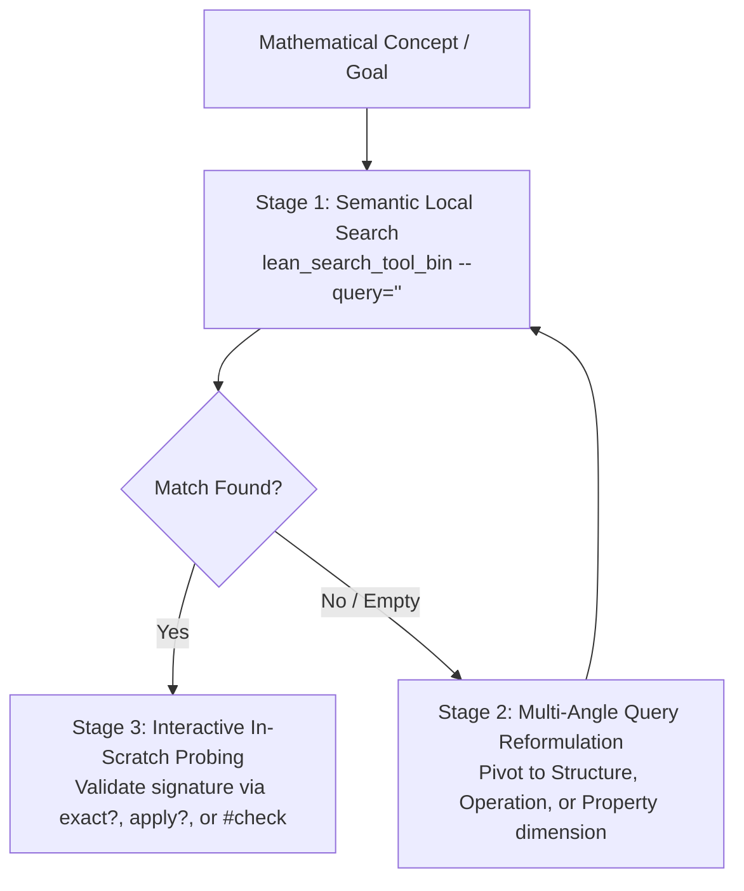

# Lean 4 & Mathlib Search & Discovery Protocol

Mathlib organizes knowledge by **canonical types, namespaces, and grammatical naming conventions**, rather than by informal textbook names.

This skill provides a version-agnostic, 4-stage search funnel to discover canonical mathematical structures and theorems dynamically from the live environment.

---

## The 3-Stage Search Funnel



---

### Stage 1: Semantic Local Mathlib Search (`lean_search_tool_bin`)
Query the indexed Mathlib embeddings directly via the CLI using the discovered structure or operational phrase:
```bash
lean_search_tool_bin \
    --query="<canonical_structure_or_operation>" \
    --num_results=5 \
    --json_output
```
* **Search by Operation / Structure**: Prefer queries like `"fiberwise sum of finite set"` or `"cardinality of Equiv.Perm"` over bare mathematician names.

---

### Stage 2: Multi-Angle Query Reformulation (Never Surrender on 1 Query)
If a search query returns no relevant results, **do NOT abandon search**. Pivot across three standardized dimensions:

1. **Structure Dimension**: Query the carrier data structure (`Equiv.Perm`, `Finpartition`, `Sym`, `Pointwise`, `Nat.digits`, `SimpleGraph`).
2. **Operation Dimension**: Query the algebraic action (`sum_comm`, `sum_fiberwise`, `card_image_of_injective`, `bUnion`).
3. **Property / Invariant Dimension**: Query the theorem shape (`_le_of_`, `_eq_of_`, `_mono`, `_injective`, `_bij`).

Consult [`references/mathlib_search_guide.md`](references/mathlib_search_guide.md) for the naming grammar and query formulation matrix.

---

### Stage 3: Interactive In-Scratch Probing (`exact?` / `apply?` / `#check`)
Never trust an assumed signature from memory. Always verify declarations against the project's actual live compiler in `scratch/attempt_1.lean`:

* **`exact?`**: Automatically searches Mathlib to find the exact lemma closing the goal.
  ```lean
  example (A B : Finset ℕ) : (A ∩ B).card ≤ A.card := by
    exact?
  ```
* **`apply?`**: Searches Mathlib for lemmas matching the goal's conclusion shape.
* **`#check @declaration_name`**: Inspects all explicit and implicit parameter types.
* **`#synth Typeclass Carrier`**: Verifies if required typeclass instances exist in the scope.

---

## Live Verification Mandate

> [!IMPORTANT]
> **Mathlib Version Invariance**: Never hardcode assumed theorem names without checking them. Always verify names and signatures live in the project's actual compiler environment.
